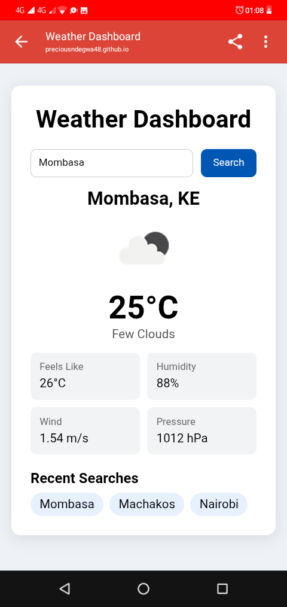

# Week 6: Weather Dashboard

## Author
- **Name:** Precious Ndegwa
- **GitHub:** [@preciousndegwa48](https://github.com/preciousndegwa48)
- **Date:** November 11, 2026

## Project Description
Weather Dashboard application built with vanilla JavaScript. The app lets you search weather by city using the OpenWeatherMap API, with loading and error states, and recent searches saved in localStorage. The repo also contains Task 11, Task 12, and Daily Challenges Day 1-5.

## Technologies Used
- HTML5
- CSS3
- JavaScript
- Fetch API
- Async/Await
- Promises
- OpenWeatherMap API
- localStorage
- GitHub Pages
- GitHub Actions

## Features
- Search weather by city name
- Shows temperature, feels-like, humidity, wind, pressure, icon, description
- Loading state while fetching
- Error handling: City not found, invalid API key, network error
- Recent Searches: last 5 cities, saved in localStorage, click to search again
- Task 11: Callbacks, Promises, Async/Await, Promise.all, Promise.race
- Task 12: Fetch API, User Directory, POST request, Search / Filter / Sort
- Daily Challenges: Delay, Sequential vs Parallel, Default User, Callback vs Promise vs Async, Promise.allSettled

## How to Run
1. Clone this repository
2. Copy `config.example.js` to `config.js` and add your key:
   `const API_KEY = "your-openweathermap-key";`
3. Get a free key at https://openweathermap.org/api
4. Open `index.html` in your browser
   OR
   Open the deployed GitHub Pages link
5. For practice files, run `node task-11.js` and `node daily-challenges.js` and open DevTools Console (F12) to see the logs

## Lessons Learned
- How async code works: Callbacks -> Promises -> Async/Await
- Difference between `setTimeout` and real async fetching
- How to use `fetch()` and check `response.ok` and `response.status`
- How to use `try / catch / finally` for loading and errors
- How to chain Promises with `.then()` and handle errors with `.catch()`
- How to run Promises in parallel with `Promise.all`, `Promise.race`, `Promise.allSettled`
- How to keep API keys safe with `config.js`, `.gitignore`, `config.example.js`, and GitHub Secrets
- How to deploy with GitHub Pages + GitHub Actions

## Challenges Faced
- **API key leaked in screenshot:** Fixed by deleting the old key, creating a new one, and never putting the real key in `config.js` on GitHub. Used `.gitignore` + GitHub Secret `OPENWEATHER_API_KEY` for deploy.
- **401 API key not valid yet:** New OpenWeatherMap keys can take up to 1 hour to activate. Fixed by waiting and showing a clear error message.
- **Callback Hell:** Nested callbacks were hard to read. Fixed by converting to Promises and then to Async/Await.
- **Duplicate function names:** `getUserData` and `showLoading` existed in both Task 11 and Task 12. Fixed by keeping practice files separate and not loading them together in `index.html`.

## Screenshots (optional)

## Live Demo (if deployed)
[View Live Demo](https://preciousndegwa48.github.io/iyf-s12-week-06-preciousndegwa48/)
